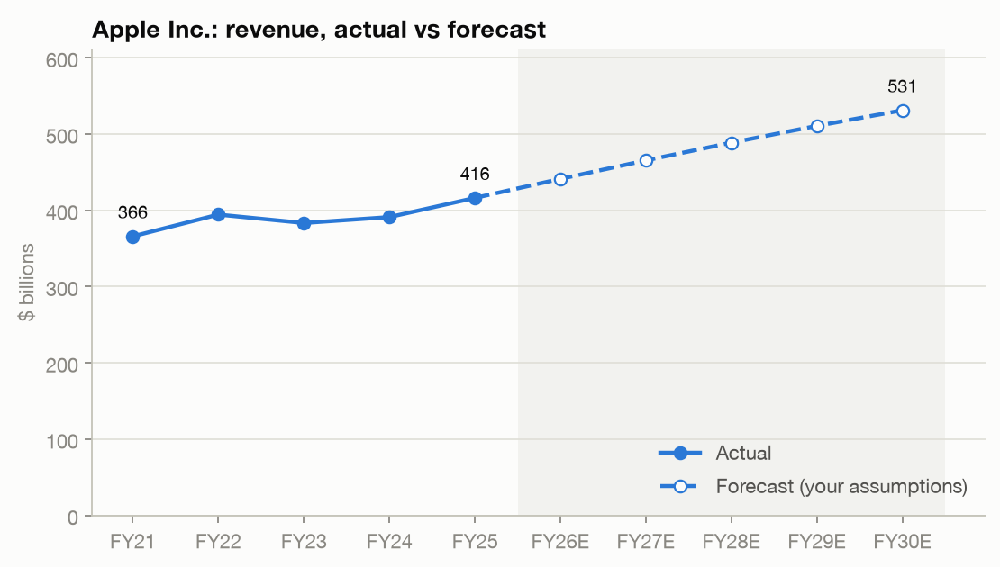
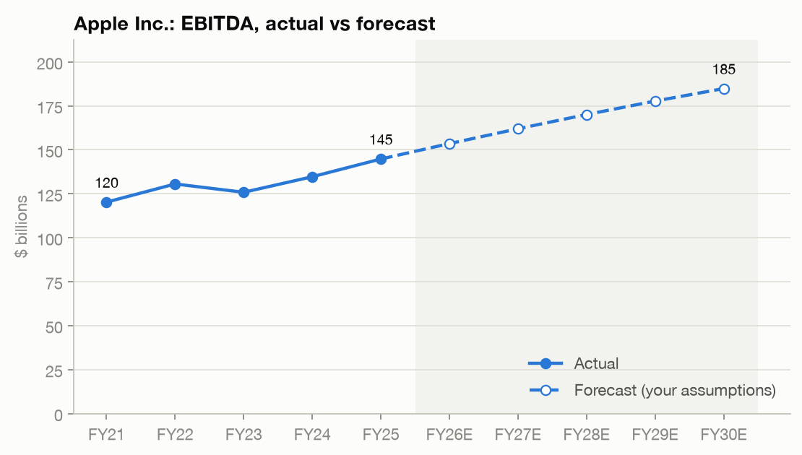
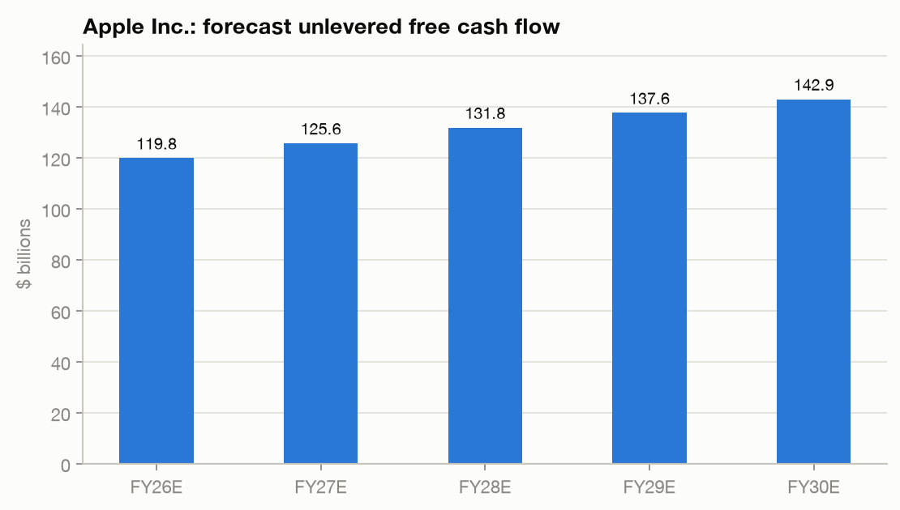
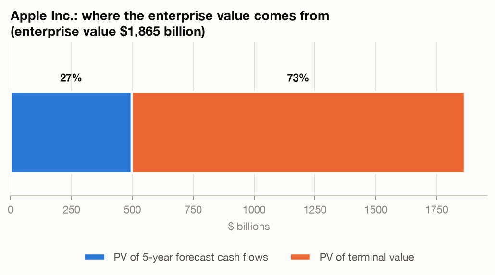
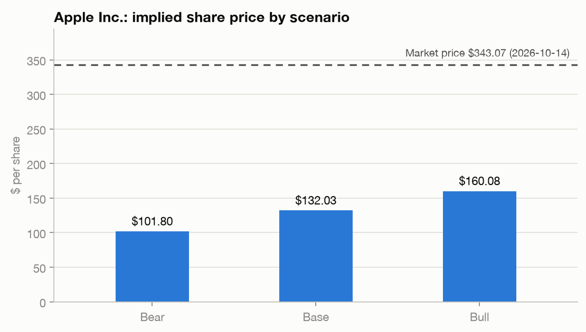
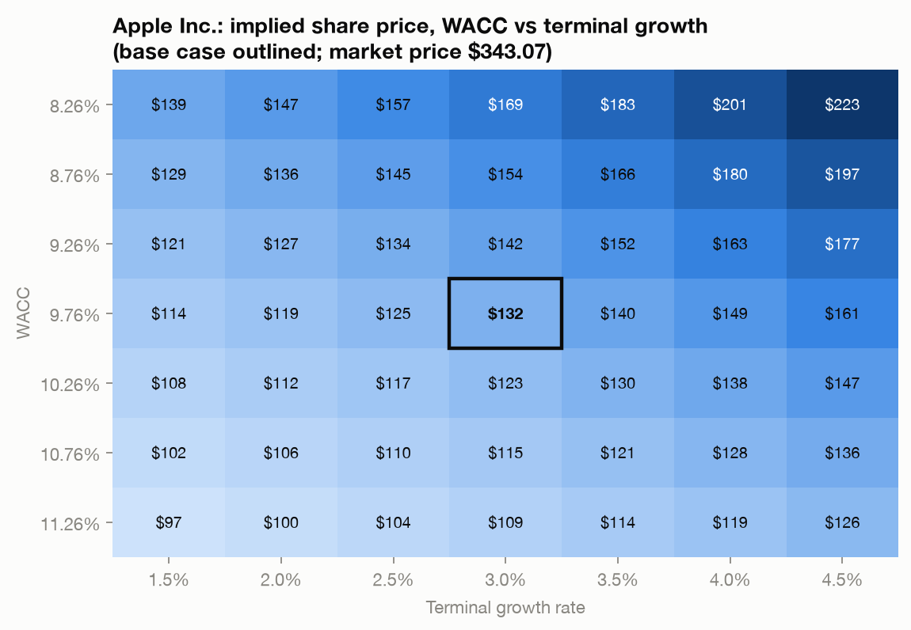

# DCF Valuation Model (Python)

A discounted cash flow (DCF) model that values a public company from its SEC filings,
its market price and a set of clearly separated analyst assumptions.

```bash
python main.py AAPL
```

It produces a one-page summary, a detailed report (historicals, forecast, UFCF, WACC,
terminal value, equity bridge, sensitivity tables, scenarios), six charts and a list of
data and assumption warnings.

> Built as a learning project. It is not investment advice. A DCF estimates value from the
> assumptions you give it; it does not predict the share price.

---

## Example: Apple (run on 14 Oct 2026)

```text
==============================================================
                        DCF VALUATION
==============================================================
Company:                  Apple Inc.
Ticker:                   AAPL
Price date:               2026-10-14
Balance sheet date:       2026-06-27 (10-Q)

Current share price:      $343.07
Enterprise value:         $1,864,731m
Equity value:             $1,926,904m
Implied share price:      $132.03
Upside / (downside):      -61.5%

WACC:                     9.76%
Terminal growth:          3.00%
Exit multiple:            20.0x
Terminal method used:     perpetuity growth
Terminal value % of EV:   73.3%
--------------------------------------------------------------
SCENARIO ANALYSIS
--------------------------------------------------------------
Bear case:                $101.80     (-70.3%)
Base case:                $132.03     (-61.5%)
Bull case:                $160.08     (-53.3%)
```

**How to read this result.** The model does *not* conclude that Apple is overvalued.
It says that with ~5% revenue growth, a 32% EBIT margin, a 9.8% WACC and 3% terminal growth,
the cash flows are worth about $132 per share. The market price of $343 implies much more
optimistic inputs: a reverse DCF shows it needs roughly a 5.6% WACC, or 7.6% perpetual
growth, or a 38x exit multiple. The analyst's job is to judge which of those is believable.

| | |
|---|---|
|  |  |
|  |  |
|  |  |

---

## How the model works

```text
SEC 10-K / 10-Q data (facts)      Yahoo Finance (price)      config/<ticker>.py (your judgements)
            \                              |                              /
             +---------------> Historical financials + ratios <---------+
                                           |
                       Forecast income statement (5 years, editable)
                                           |
   Unlevered free cash flow = EBIT - taxes on EBIT + D&A - CapEx - increase in NWC
                                           |
                 WACC (CAPM cost of equity + after-tax cost of debt, market weights)
                                           |
        Discount each year's UFCF  +  terminal value (perpetuity growth or exit multiple)
                                           |
                                   Enterprise value
                 + cash - debt - preferred stock - minority interest
                                           |
                       Equity value / shares = implied share price
                                           |
              Sensitivity grids, Bear/Base/Bull scenarios, checks and charts
```

Key modelling choices:

- **Unlevered free cash flow**, never net income, so the cash flows match a WACC
  (a discount rate for all investors).
- **End-of-year discounting**: year *t* cash flow is divided by (1 + WACC)^t.
- **Two terminal value methods**, each cross-checked against the other (implied exit
  multiple and implied perpetual growth). The model stops if WACC <= terminal growth.
- **One balance sheet date** for cash, debt and long-term securities in the equity bridge
  (the latest 10-K or 10-Q), so numbers from different dates are never mixed.
- **Warnings instead of silence**: missing items, unusual tax rates, terminal value above
  75% of EV, and large gaps to the market price are all reported.

---

## Data sources

| Data | Source | Notes |
|---|---|---|
| Income statement, balance sheet, cash flow items | SEC EDGAR XBRL "companyfacts" API | Official filings. Each item records whether it was FILED, DERIVED or ASSUMED 0. |
| Share count | 10-K / 10-Q cover page (`dei:EntityCommonStockSharesOutstanding`) | Basic shares; a small dilution effect is ignored. |
| Share price, price history | `yfinance` (unofficial Yahoo Finance) | Personal and educational use. The model calculates its own beta (5 years of monthly returns vs the S&P 500) as a cross-check; the beta actually used is set in the config file. |
| Risk-free rate, equity risk premium, cost of debt, forecast, terminal inputs | You, in `config/<ticker>.py` | Judgements, kept separate from facts. |

Always check against the filings: cash and debt definitions (leases are excluded), share count,
one-off tax items, and any line item the model marks ASSUMED 0.

---

## Project structure

```text
dcf-model/
├── main.py                  # run the model: python main.py AAPL
├── config/
│   └── aapl.py              # Apple assumptions, scenarios and data overrides
├── src/
│   ├── data.py              # Maple Coffee Co. sample data and input checks
│   ├── sec.py               # download and cache SEC data
│   ├── sec_financials.py    # turn SEC facts into clean historical statements
│   ├── market.py            # share price and beta from Yahoo Finance
│   ├── company.py           # combine filings + market data + config for a ticker
│   ├── historicals.py       # historical statements and ratios
│   ├── assumptions.py       # assumption classes and validation
│   ├── forecast.py          # forecast income statement and UFCF
│   ├── valuation.py         # WACC, discounting, terminal value, equity bridge
│   ├── sensitivity.py       # WACC vs growth and WACC vs exit multiple grids
│   ├── scenarios.py         # Bear / Base / Bull
│   ├── model.py             # runs the whole pipeline
│   ├── display.py           # detailed tables
│   ├── report.py            # one-page summary
│   └── visualization.py     # charts
├── tests/                   # pytest unit tests
├── data/raw/                # downloaded data (not in Git)
├── outputs/                 # summary and charts (not in Git)
├── docs/images/             # example charts for this README
├── local_settings.example.py
└── requirements.txt
```

---

## Setup

Requires Python 3.11 or newer.

```bash
git clone https://github.com/Siddharth-Dhakadey/dcf-model.git
cd dcf-model
python3 -m venv .venv
source .venv/bin/activate          # Windows: .venv\Scripts\activate
python -m pip install -r requirements.txt
cp local_settings.example.py local_settings.py
```

Then edit `local_settings.py` and enter your name and email. The SEC requires every request
to identify who is asking. This file is in `.gitignore` and is never committed.

---

## Usage

```bash
python main.py              # asks for a ticker
python main.py AAPL         # full report for Apple
python main.py AAPL --short # one-page summary only
python main.py MAPLE        # the hypothetical teaching company
python -m pytest            # run the tests
```

Output files are written to `outputs/` (`AAPL_summary.txt` and six charts).

The tests (48) check every formula against a hypothetical company whose answers can be
worked out by hand, plus the SEC parsing, market data checks, charts and summary page.

### Valuing another company

1. Copy `config/aapl.py` to `config/<ticker>.py` (lower case, e.g. `config/msft.py`).
2. Read the company's latest 10-K and change every assumption: growth, margins, tax rate,
   CapEx, working capital, WACC inputs, terminal growth, exit multiple and scenarios.
3. Run `python main.py MSFT` and read every warning before trusting the result.

---

## Limitations

- Forecasts are only as good as the assumptions in the config file.
- The SEC data mapping is tested on Apple. Other companies may use different XBRL tags,
  which can lead to items marked ASSUMED 0. Check them against the filing.
- Banks, insurers and REITs need different models (their debt is part of operations).
- Lease liabilities, stock-based compensation and share dilution are not yet modelled.
- Yahoo Finance data is unofficial and may change or fail without notice.
